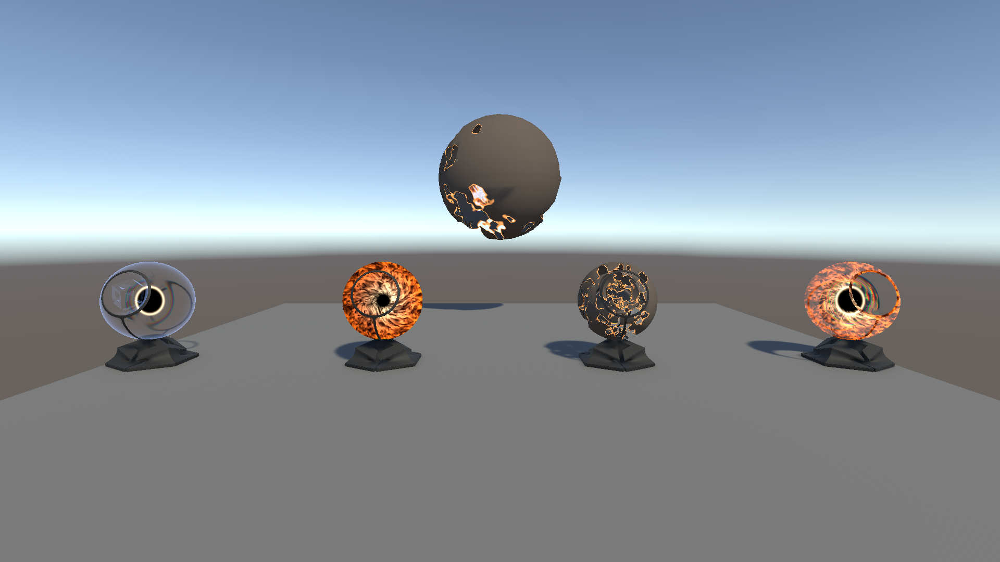
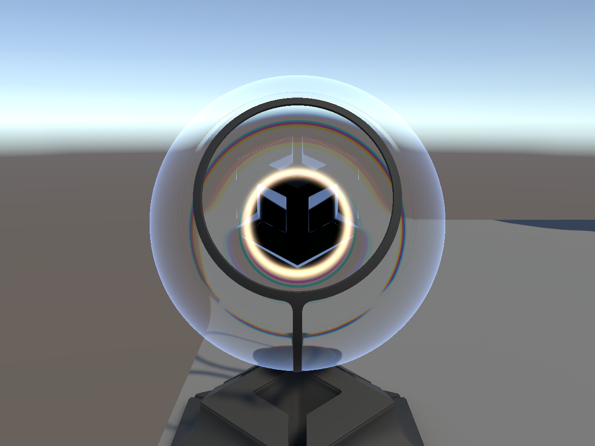
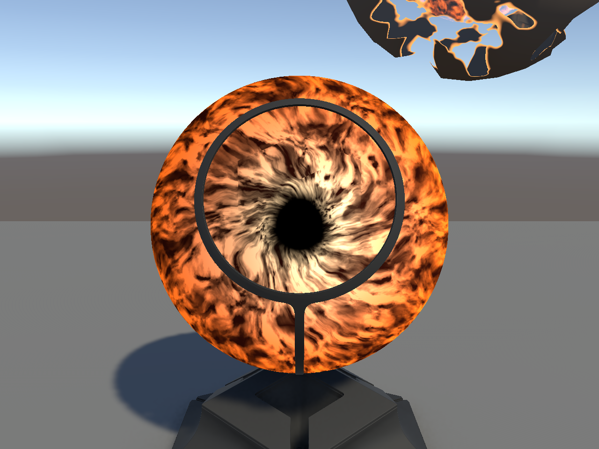
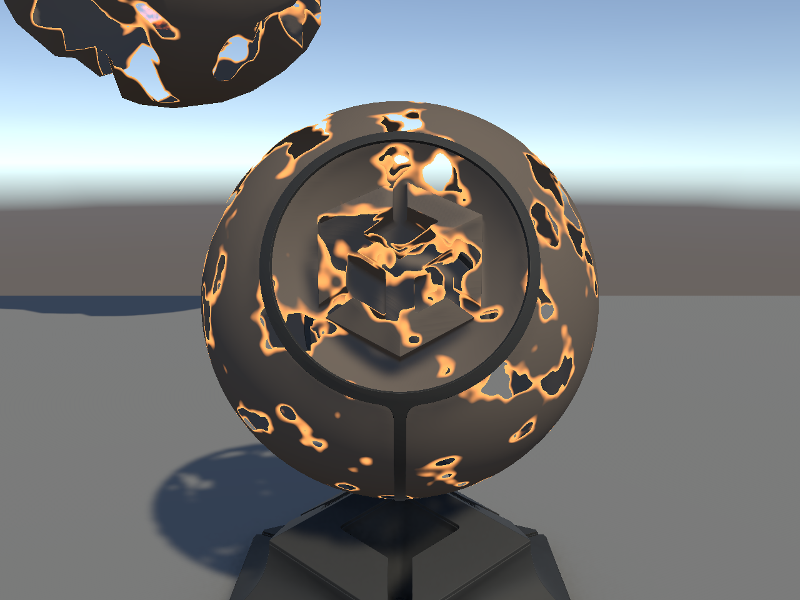
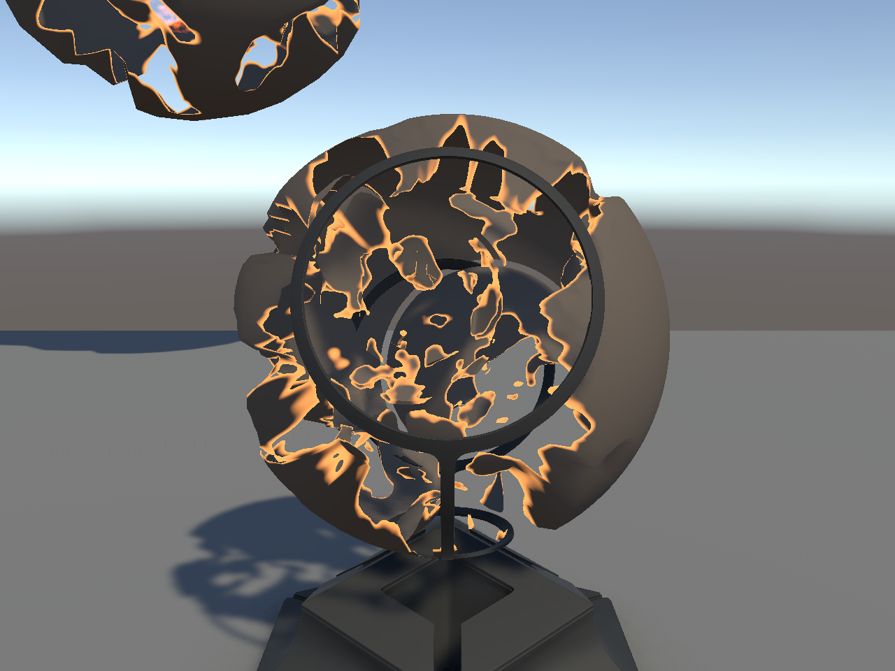
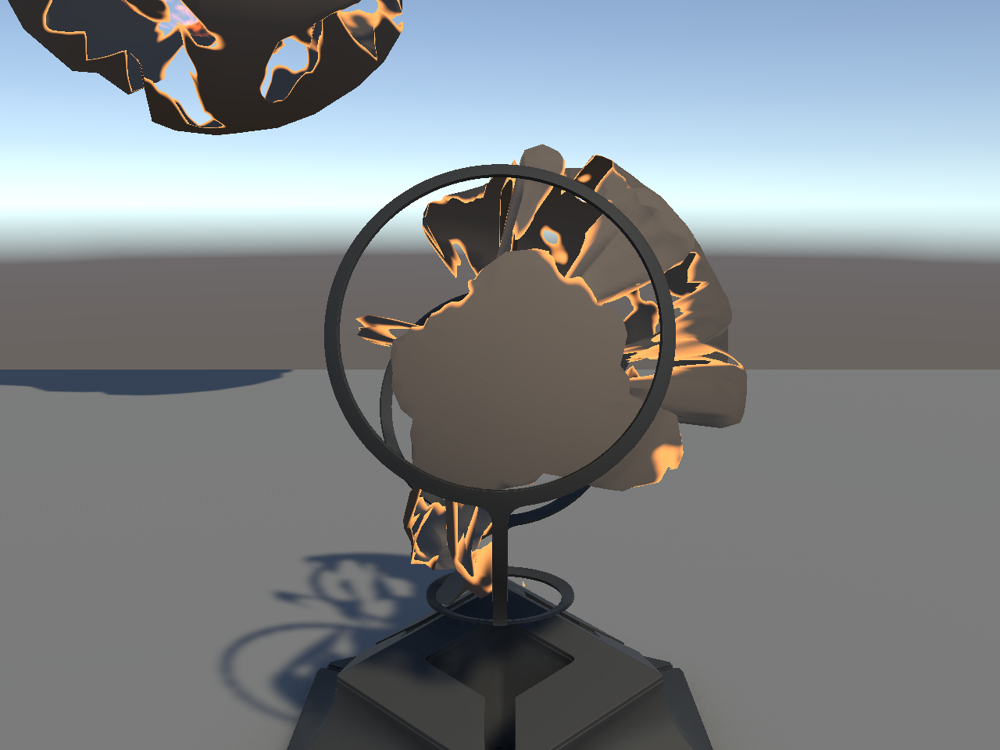
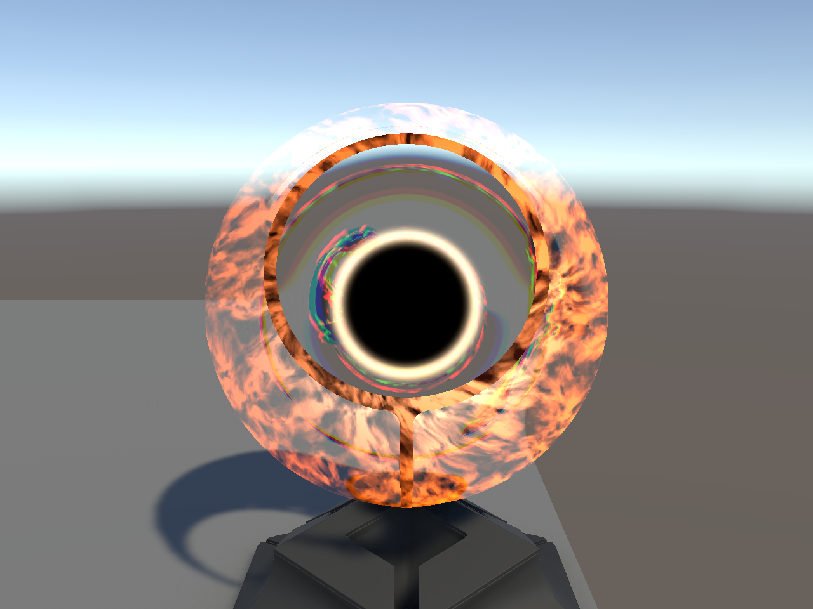
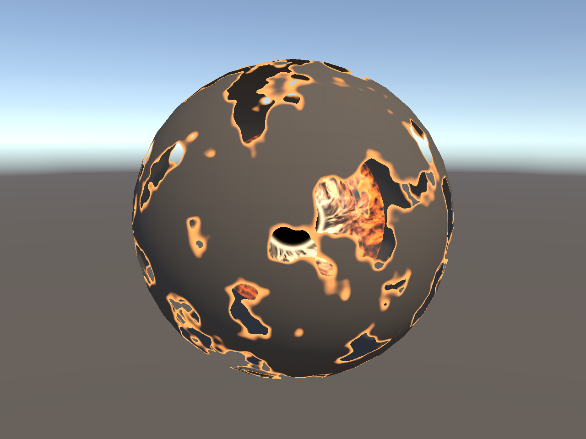
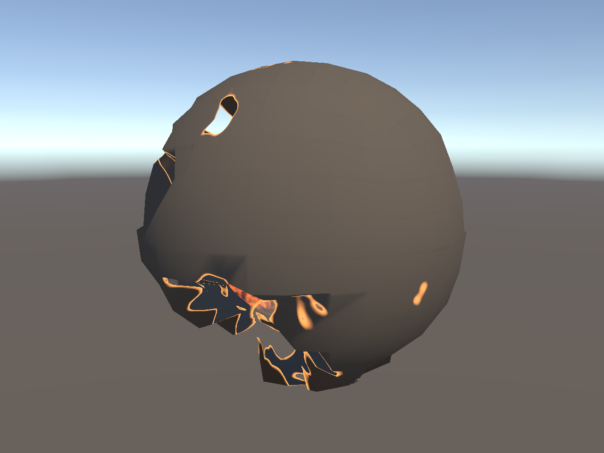
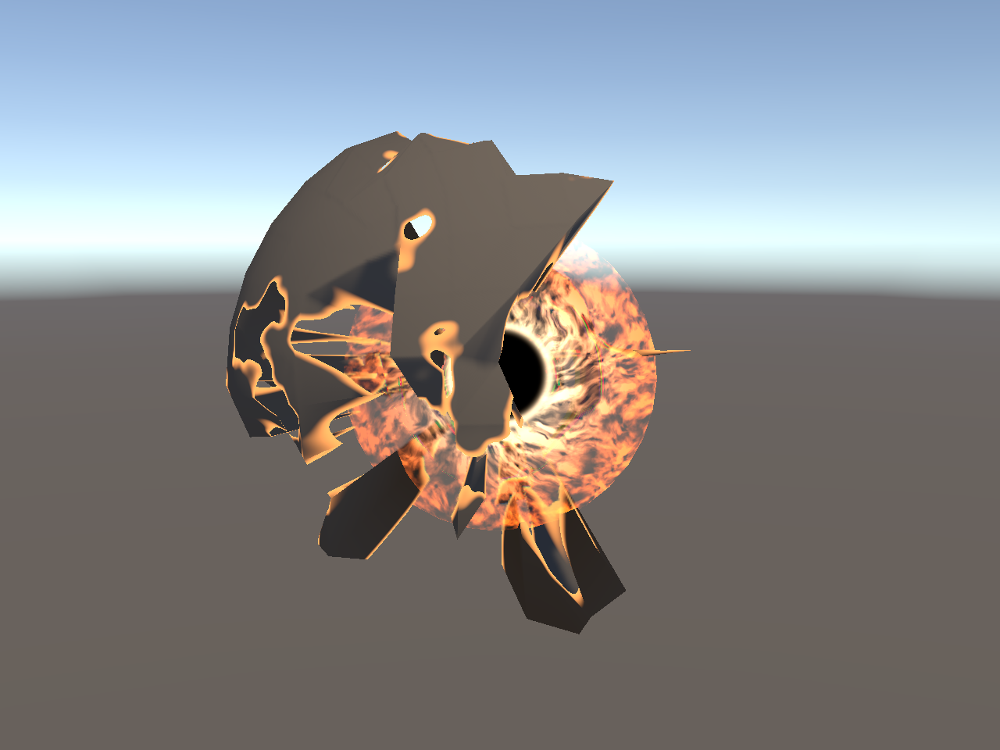

# 나만의 셰이더 제작 — 블랙홀

`Study Shader` 씬의 셰이더볼 4개와 공중의 구체로 블랙홀을 만들었습니다.
- **볼 1~3**은 갤러리 기법을 하나씩 바꿔 만든 셰이더입니다.
- **볼 4**와 **행성의 죽음**은 새 셰이더 없이, 볼 1~3의 머티리얼을 파트별로 나누거나 겹쳐서 만들었습니다.
- 후처리(포스트프로세싱)는 쓰지 않았습니다. 모든 효과는 머티리얼 셰이더 안에서 만듭니다.



| 볼 (왼쪽부터) | 셰이더 | 바탕이 된 갤러리 표본 | 한 줄 요약 |
| --- | --- | --- | --- |
| 1 | `MyShaders/GravityLens` | 씬 컬러 굴절 유리 | 뒤 장면이 중심으로 휘어 보이는 렌즈 |
| 2 | `MyShaders/AccretionFlow` | 플로 맵 액체 | 중심으로 빨려 드는 뜨거운 가스 소용돌이 |
| 3 | `MyShaders/DebrisDissolve` | 디졸브 | 생겨났다가 중심으로 빨려 들며 타 사라지는 잔해 |
| 4 | 위 3개 | 위 3개 조합 | 파트마다 다른 머티리얼 + 머티리얼 겹치기 |
| 행성의 죽음 | 위 3개 | 위 3개 조합 | 블랙홀에 행성 지표가 빨려 드는 구체 |

## 파일 구조

```
Assets/02. MyShaders/
├─ Shared/BlackHoleCommon.hlsl      ← 3개 셰이더가 함께 쓰는 함수
├─ Shared/Textures/                 ← 소용돌이 플로 맵, 가스 무늬 텍스처
├─ 01_GravityLens/                  GravityLens.shader, .mat
├─ 02_AccretionFlow/                AccretionFlow.shader, .mat
├─ 03_DebrisDissolve/               DebrisDissolve.shader, .mat
├─ 04_BlackHoleCombo/               볼 4 파트용 머티리얼 (셰이더 없음)
└─ 05_PlanetDeath/                  행성의 죽음용 머티리얼 (셰이더 없음)
```

> 셰이더볼 파트와 구 모두 **피벗이 구의 중심**에 있습니다. 그래서 세 셰이더 모두 오브젝트의 원점을 블랙홀 중심으로 쓰고, 중심 위치를 따로 맞추는 값이 없습니다.

---

## 1. GravityLens — 중력 렌즈



**무엇이 보이나**
구 뒤의 장면이 중심 쪽으로 빨려 들 듯 휘어 보입니다. 중심은 완전히 검고(사건의 지평선), 그 바로 바깥에 얇은 빛 고리가 있습니다.

**어떻게 보이게 했나**
- 불투명한 물체가 다 그려진 화면을 한 장 받아 둔 뒤에 구를 그립니다.
- 구의 각 픽셀은 그 화면에서 **자기 자리 말고 조금 다른 자리의 색**을 가져옵니다.
- 중심에 가까울수록 더 먼 자리의 색을 가져와서 장면이 휘어 보입니다. 아주 가까운 곳은 반대편 색을 가져와 뒤집혀 보입니다.

**값 바꿔 보기**

| 프로퍼티 | 올리면 | 내리면 / 0이면 |
| --- | --- | --- |
| Einstein Radius (`_Einstein`) | 빛 고리가 커지고, 뒤집혀 보이는 안쪽이 넓어짐 | 0이면 휘지 않고 그냥 투명한 구 |
| Lens Radius (`_LensRadius`) | 실제 구 크기에 맞춰야 함. 너무 크면 휨이 구 밖까지 있는 것처럼 계산되어 테두리에서 어긋남 | 너무 작으면 휨이 중심에만 몰림 |
| Edge Falloff Start (`_FalloffStart`) | 휨이 테두리 가까이까지 남음. 1에 가까우면 구 테두리에서 장면이 뚝 끊겨 보임 | 휨이 안쪽에서 일찍 풀려 테두리가 자연스러움 |
| Chromatic Aberration (`_Chroma`) | 휜 부분의 경계가 무지개처럼 번짐 | 0이면 색 번짐 없음 |
| Horizon Radius (`_Horizon`) | 검은 원이 커짐 | 0이면 검은 원 없음 |
| Photon Ring Color (`_RingColor`) | 빛 고리가 밝고 진해짐 (HDR) | 검정이면 고리 없음 |
| Rim Color / Rim Power | 구 테두리의 푸른 빛. Power를 올리면 테두리 띠가 얇아짐 | Power를 내리면 빛이 구 안쪽까지 퍼짐 |

**갤러리 원본(씬 컬러 굴절 유리)에서 바꾼 점**
- 원본은 표면 방향으로 좌표를 밀었지만, 여기서는 **모든 픽셀을 블랙홀 중심 방향**으로 밀었습니다. 블랙홀은 빛을 한 점으로 끌어당기기 때문입니다.
- 유리의 일렁이는 노이즈와 유리 색을 빼고, 검은 원과 빛 고리를 더했습니다.
- 원본의 색수차, 테두리 빛(프레넬), **앞에 있는 물체는 끌어오지 않기**는 그대로 썼습니다. 마지막 처리가 없으면 볼 앞의 링이 렌즈 속으로 끌려 들어와 보입니다.

---

## 2. AccretionFlow — 강착원반 소용돌이



**무엇이 보이나**
뜨거운 가스가 돌면서 중심의 검은 구멍으로 빨려 들어갑니다. 중심에 가까울수록 빨리 돌고 하얗게 뜨거우며, 한쪽이 조금 더 밝습니다.

**어떻게 보이게 했나**
- **플로 맵**은 "이 자리의 가스는 어느 방향으로 흐르는가"를 색으로 적어 둔 텍스처입니다. 여기에는 "돌면서 중심으로 빨려 드는 방향"을 그려 넣었습니다.
- 가스 무늬를 그 방향대로 계속 밀면 무늬가 점점 늘어나 망가집니다. 그래서 일정 시간마다 원래 모양으로 되돌리는데, 그냥 되돌리면 '툭' 튀어 보입니다. 이를 숨기려고 반 박자 어긋난 무늬 두 장을 번갈아 섞습니다(갤러리 원본과 같은 방법).
- 크기와 속도가 다른 흐름 두 층을 겹쳐서, 둘 다 밝은 곳에만 가는 가스 줄기가 남게 했습니다.
- 구에서는 메시 UV 대신, 어느 각도에서 봐도 소용돌이 중심이 관찰자를 향하도록 좌표를 만들었습니다.

**값 바꿔 보기**

| 프로퍼티 | 올리면 | 내리면 / 0이면 |
| --- | --- | --- |
| Flow Strength | 무늬가 흐름 방향으로 길게 늘어남 | 0이면 무늬가 멈춰 있음 |
| Flow Speed | 흐름이 빨라짐 | 느려짐 |
| Pattern Scale | 무늬가 잘아짐 | 무늬가 커짐 |
| Detail Layer Scale | 가스 줄기가 가늘고 촘촘해짐 | 줄기가 굵어짐 |
| Phase Noise | 되돌리는 순간이 자리마다 흩어져 자연스러움 | 0이면 표면 전체가 동시에 '툭' 튀는 순간이 보임 |
| Deep / Bright / Hot Color | 어두운 곳, 밝은 곳, 중심 근처의 가장 뜨거운 곳 색 | |
| Heat Falloff | 뜨거운 색이 중심 근처에만 좁게 모임 | 뜨거운 색이 바깥까지 퍼짐 |
| Bright Glow | 밝은 줄기가 더 빛남 | 0이면 발광 없음 |
| Doppler Brightness | 한쪽(다가오는 쪽)이 더 밝고 반대쪽이 어두워짐 | 0이면 양쪽 밝기가 같음 |
| Core Radius / Softness | 검은 핵이 커짐 / 핵 경계가 흐려짐 | 핵이 작아짐 / 경계가 또렷해짐 |
| Mode | `Additive`: 아래 그려진 것 위에 밝기만 더함 (볼 4 참고) | `Opaque`: 표면 자체가 가스 |

**갤러리 원본(플로 맵 액체)에서 바꾼 점**
- 플로 맵, 두 장 번갈아 섞기, 어두운 색과 밝은 색 섞기는 원본과 같습니다.
- 플로 맵 내용을 "돌면서 빨려 드는 소용돌이"로 직접 만들었고, 소용돌이 좌표, 흐름 두 층, 온도 색, 한쪽 밝기, 검은 핵을 더했습니다.
- 스스로 빛나는 가스라서 조명은 뺐습니다.

---

## 3. DebrisDissolve — 생성되고 중심으로 빨려 드는 잔해

| 생성 중 (Threshold 0.1) | 흡입 초반 (0.5) | 흡입 후반 (0.75) |
| --- | --- | --- |
|  |  |  |

**무엇이 보이나**
표면이 타오르며 생겨나고, 잠시 온전히 있다가, 덩어리째 떨어져 나가 돌면서 중심으로 빨려 들고, 타 사라집니다. 이 과정이 계속 반복됩니다.

**어떻게 보이게 했나**
- 원본 디졸브처럼 표면 곳곳에 노이즈 값을 두고, 기준값보다 작은 곳을 지웁니다. 지워지는 경계 바로 옆은 주황색으로 빛납니다.
- Threshold 0~1을 **한 바퀴의 시간**으로 씁니다. 처음 구간은 디졸브를 거꾸로 돌려 **생성**, 가운데는 **유지**, 뒷부분은 **흡입**입니다. Auto Play를 켜면 이 값이 저절로 계속 돕니다.
- 흡입 구간에서는 덩어리마다 출발 시간을 다르게 해서, 덩어리째 중심으로 끌려가며 타 사라집니다. 끌려가는 동안 남은 지표 전체가 점점 빨리 돕니다.
- 그림자도 같은 모양으로 움직이고 잘립니다.

**값 바꿔 보기**

| 프로퍼티 | 올리면 | 내리면 / 0이면 |
| --- | --- | --- |
| Auto Play | 켜면 저절로 반복 | 끄면 Threshold 슬라이더로 원하는 순간에 멈춰 볼 수 있음 |
| Cycle Speed | 한 바퀴가 빨라짐 | 느려짐 |
| Noise Scale | 구멍이 잘고 많아짐 | 구멍이 크고 적어짐 |
| Edge Width / Edge Color | 타는 띠가 두꺼워짐 / 띠 색과 밝기 | 0에 가까우면 타는 띠 없이 그냥 사라짐 |
| Form Duration | 생겨나는 시간이 길어짐 | 순식간에 나타남 |
| Pull Start | 흡입이 늦게 시작됨 (온전한 시간이 길어짐) | 생겨나자마자 빨려 듦 |
| Pull Duration per Chunk | 덩어리 하나가 천천히 끌려감, 덩어리끼리 출발 차이가 줄어듦 | 덩어리가 휙 끌려가고, 하나씩 떨어져 나가는 느낌이 강해짐 |
| Chunk Size | 떨어져 나가는 덩어리가 잘아짐 | 큰 덩어리째 떨어져 나감 |
| Fall Acceleration | 표면에 버티다가 중심 근처에서 확 빨려 듦 | 처음부터 일정한 속도로 끌려감 |
| Swirl Turns | 흡입 동안 더 많이 돎 | 0이면 돌지 않고 곧장 빨려 듦, 음수면 반대로 돎 |

**갤러리 원본(디졸브)에서 바꾼 점**
- 노이즈로 지우기, 경계 빛나기, 그림자도 같이 자르기는 원본과 같습니다.
- 원본은 C# 스크립트로 Threshold를 올렸지만, 여기서는 셰이더 안에서 저절로 반복합니다.
- 한 바퀴를 생성, 유지, 흡입으로 나누고, 덩어리가 중심으로 돌며 끌려가는 움직임을 더했습니다.

**해 보고 뺀 것**
- 처음에는 덩어리마다 회전량을 다르게 했습니다. 그랬더니 옆 덩어리끼리 각도 차이가 커서 경계가 옆으로 찢기고, 큰 판처럼 늘어났습니다.
- 그래서 남은 지표 전체가 함께 돌게 하고, 덩어리별 추가 회전은 중심에 거의 다 와서 작아진 뒤에만 붙였습니다.

---

## 4. 볼 4 — 블랙홀 (기존 3개 조합)



새 셰이더 없이 볼 1~3의 머티리얼만으로 만들었습니다.
- **파트별로 나누기**: 셰이더볼 파트마다 다른 머티리얼을 넣었습니다.
- **머티리얼 겹치기**: 한 파트에 머티리얼 슬롯을 두 개 두면, Unity가 같은 메시를 두 번 그립니다. 그래서 한 표면에 두 효과가 차례로 그려집니다.

| 파트 | 머티리얼 | 보이는 것 |
| --- | --- | --- |
| `Ball_Part` (구 본체) | `BH_EventHorizon`(렌즈) + `BH_GasOverlay`(가스, Additive) | 휜 뒤 장면 위로 가스가 흐름 |
| `Front_Part` + 앞 로고 | `BH_EventHorizon`(렌즈) | 본체와 같은 머티리얼이라 렌즈와 검은 원이 끊기지 않고 이어짐 |
| `Rings` | `BH_AccretionRing`(가스, Opaque) | 볼을 두르는 빛나는 강착원반 |
| `Back_Part_1/2` + 뒤 로고 | `BH_BackDebris`(잔해) | 뒤 패널이 생겨났다가 볼 중심으로 빨려 듦 |

**그리는 순서**
1. 링과 뒤 패널(불투명)이 먼저 그려지고, 화면 한 장에 찍힙니다.
2. 렌즈가 그 화면을 휘어서 그립니다. 그래서 부서지는 뒤 패널과 링이 렌즈 너머로 휘어 보입니다.
3. 마지막으로 가스(Additive)가 그 위에 밝기만 더합니다. 가스의 어두운 색을 검정으로 두어서, 무늬가 어두운 곳은 아무것도 더해지지 않고 렌즈가 그대로 보입니다.

**해 보고 뺀 것**
- **렌즈 안에 가스 구 넣기**: 렌즈가 가스도 휘게 하려고, 렌즈 구 안에 불투명 가스 구를 넣어 봤습니다. 그랬더니 가스 구의 둥근 모양이 그대로 드러났고, 대비가 강한 가스에 색수차가 걸려 무지개처럼 번졌습니다.
- **가스에 렌즈 휨 직접 적용**: 가스 좌표에 렌즈와 같은 휨을 넣어 봤습니다. 그랬더니 플로 맵이 만드는 흐름과 휨이 두 겹으로 겹쳐서 어수선했습니다. 할 거라면 흐름 없이 휨만으로 움직임을 만들어야 깔끔했을 것 같습니다.
- 두 방법 모두 되돌리고, 가스를 렌즈 위에 더하는 겹치기로 정했습니다.

---

## 5. 행성의 죽음 — 구체 조합 (`PlanetDeath`)

| 행성 생성 | 블랙홀에 삼켜짐 | 블랙홀만 남음 |
| --- | --- | --- |
|  |  |  |

볼들 뒤 공중에 같은 중심의 구체 2개를 띄웠습니다. 행성이 생겨나고, 한가운데의 블랙홀에 지표가 빨려 들어가 사라지기를 반복합니다.

| 오브젝트 | 머티리얼 | 보이는 것 |
| --- | --- | --- |
| `BlackHole` 구 (반지름 0.7) | `PD_Lens`(렌즈) + `PD_GasOverlay`(가스, Additive) | 검은 원, 휘는 장면, 소용돌이 가스 (볼 4 본체와 같은 겹치기) |
| `SurfaceLayer_0` 구 (반지름 1.2) | `PD_SurfaceLayer_0`(잔해) | 행성 지표. 생성 → 흡입 반복 |

- 지표가 블랙홀 구 안쪽으로 끌려 들어가면 렌즈에 휘어 보이다가 검은 원 속으로 사라집니다.
- 지표에 구멍이 뚫리면 그 사이로 중심의 빛 고리와 가스가 드러나고, 지표가 다 사라지면 블랙홀만 남습니다.

---

## 확인 방법

- `Assets/00. Scenes/Study Shader.unity`를 열고 Game 뷰에서 봅니다.
- 소용돌이와 잔해는 시간에 따라 움직입니다. Play 모드에서 보거나, Scene 뷰 상단의 Effects에서 **Always Refresh**를 켜면 움직임이 보입니다.
- 잔해는 머티리얼의 `Auto Play`를 끄고 `Threshold`를 움직이면 원하는 순간에 멈춰 볼 수 있습니다.
- URP Asset(PC)의 **Opaque Texture와 Depth Texture가 켜져 있어야** 렌즈가 보입니다. 이 프로젝트는 이미 켜져 있습니다.
